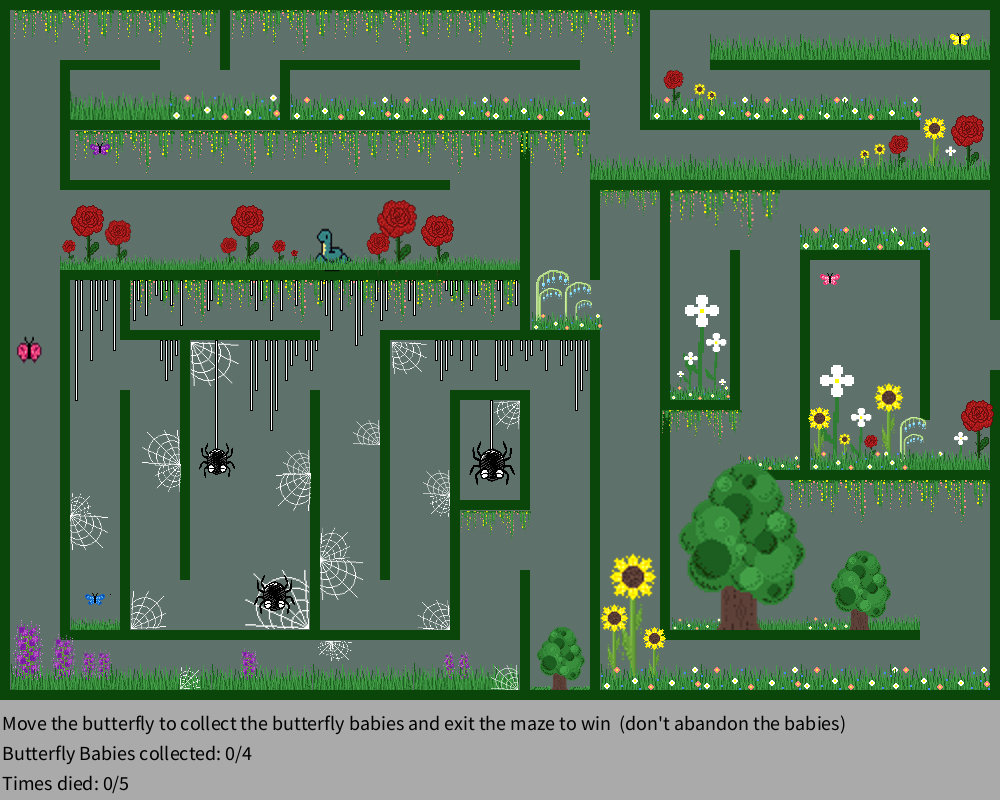

# Butterfly Maze

**Guide your butterfly through the garden maze, rescue all four babies, and find the exit — without getting caught.**

A 2D maze game built in Processing (Java mode). Navigate winding garden paths, dodge the patrolling snake and lurking spiders, collect the four baby butterflies, and escape the maze. You have 5 lives — use them wisely.



## Features

- Hand-designed maze with garden visuals — flowers, hanging plants, and spiderwebs
- Four collectible baby butterflies (blue, pink, purple, yellow) to rescue
- Enemies with collision: a patrolling snake and spiders guarding web zones
- Lives system — 5 deaths allowed, tracked on the HUD
- Win condition: collect all 4 babies, then exit the maze
- 1,000+ lines of code across 7 tabs: game loop, movement and collision, maze rendering, sprite classes, HUD, and end-game states

## Requirements

- Processing 4 (free at [processing.org](https://processing.org))

## How to Run

1. Clone the repository:
   ```bash
   git clone [repo-url]
   ```
2. Open `VideoGame.pde` in Processing — open the sketch folder so all 7 tabs load
3. Press the Run button (▶)

## How to Play

- Move with **WASD** (W = up, A = left, S = down, D = right)
- Collect all **4 baby butterflies**
- Avoid the **snake** and the **spiders/spiderwebs** — touching them costs a life
- You have **5 lives**; lose them all and it's game over
- Once all babies are collected, find the **exit** to win

## Project Structure

```
VideoGame/
├── VideoGame.pde           # main sketch — draw loop
├── Image_Display.pde       # setup, image loading, baby-butterfly collection
├── Movement.pde            # WASD input, animation, wall/snake collision
├── Lines.pde               # maze walls and spiderweb line art
├── Classes.pde             # Spider, Spiderweb, Flower, Plant classes
├── Game_Directions.pde     # HUD and end-game states
├── Spiderweb_Collision.pde # web collision zones
└── data/                   # 20 sprite images
```

## Author

Created by **Maria Parfitt**, 2026.
